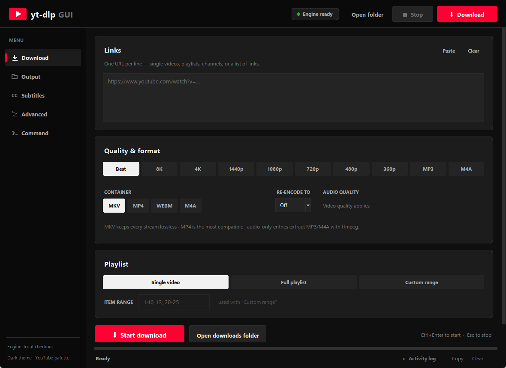
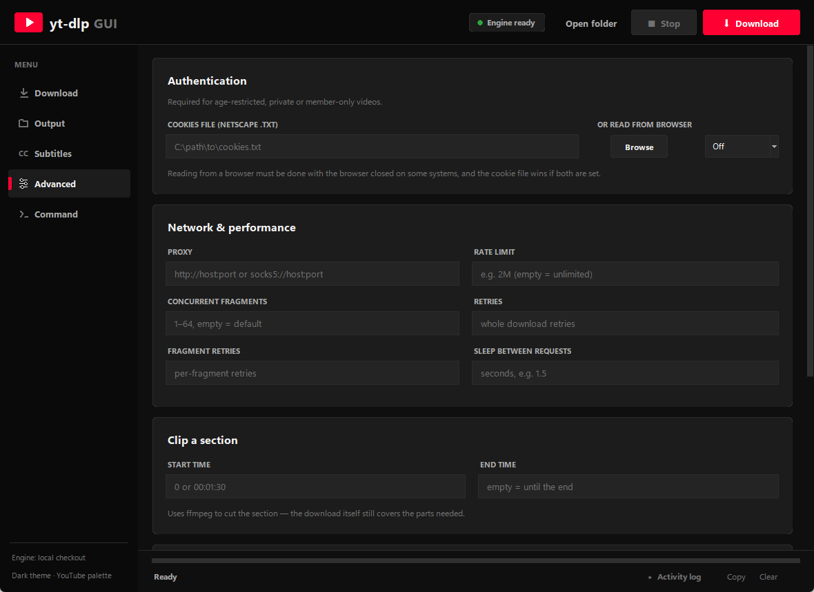
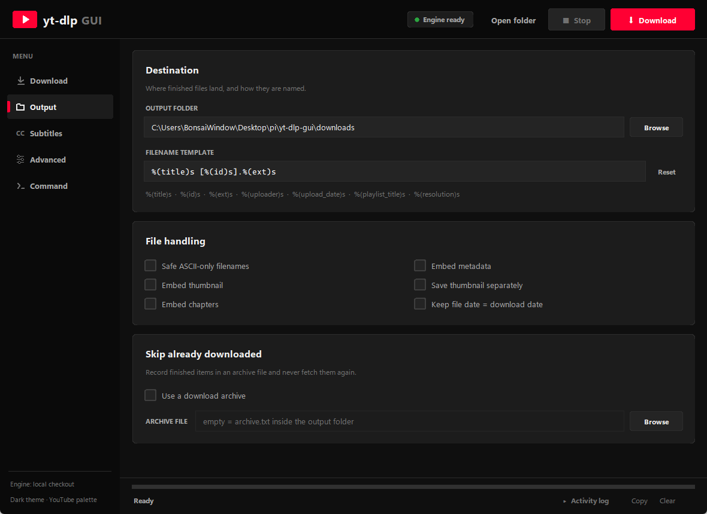
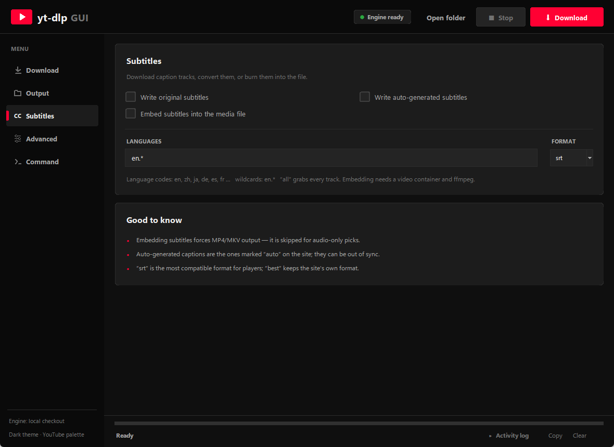
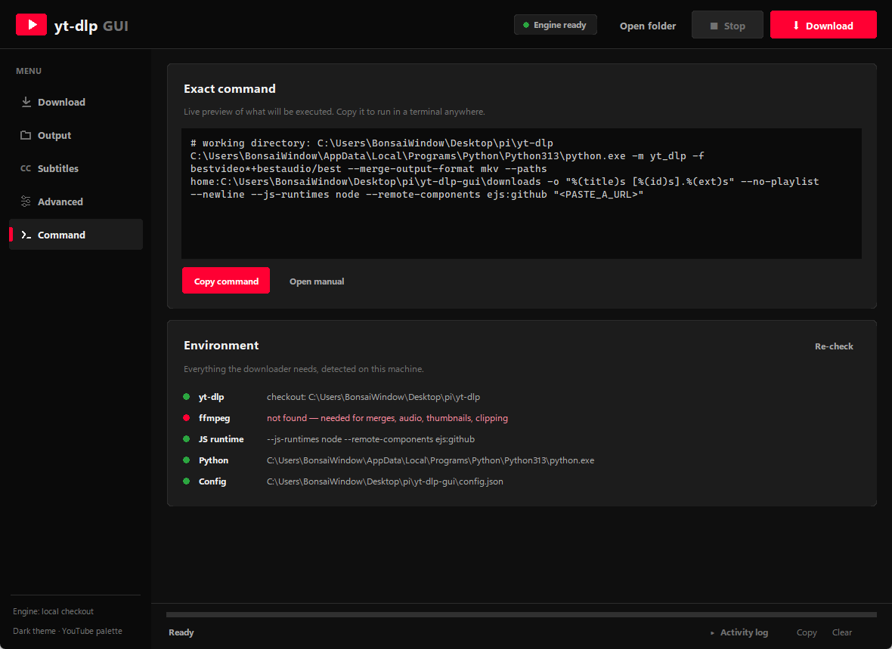

# yt-dlp GUI

A modern, dark-mode desktop GUI for [yt-dlp](https://github.com/yt-dlp/yt-dlp) with a
YouTube-inspired look. Pure Python + Tkinter — **no third-party dependencies**.



Every common yt-dlp feature is exposed in the UI — quality and container, playlists,
subtitles, metadata/thumbnail embedding, cookies, proxy, rate limits, clipping,
SponsorBlock, and a live preview of the exact command that will run.

---

## Contents

- [Quick start](#quick-start)
- [Launchers](#launchers)
- [Screenshots](#screenshots)
- [Features](#features)
- [How the code is organised](#how-the-code-is-organised)
- [Running the tests](#running-the-tests)
- [Building a standalone app](#building-a-standalone-app)
- [Configuration](#configuration)
- [Troubleshooting](#troubleshooting)

---

## Quick start

Requires **Python 3.9+** with Tkinter (bundled with the python.org Windows/macOS
installers; `python3-tk` on Linux).

```bash
git clone --depth 1 https://github.com/yt-dlp/yt-dlp        # the engine
git clone https://github.com/<you>/yt-dlp-gui.git           # this GUI
cd yt-dlp-gui

python yt_dlp_gui.py          # launch
python yt_dlp_gui.py --selftest   # check engine / ffmpeg / JS runtime
```

The GUI looks for the engine in this order: `YTDLP_HOME` → `<app>/yt-dlp`
(bundled build) → `../yt-dlp` (the layout above) → `yt-dlp` on `PATH`.

**Windows without installing Python:** build the standalone exe once with
`build\windows-build-onefile.bat`, then just double-click
**`dist\yt-dlp-gui.exe`** — one self-contained file (~31 MB) bundling Python and
the yt-dlp engine. Nothing else to install.

Windows users *with* Python can double-click **`run.bat`**; macOS/Linux users
can run **`./run.sh`**.

> **ffmpeg** is needed for merging streams, MP3/M4A audio, thumbnails, chapters,
> clipping and SRT conversion. Without it, downloads still work but stay unmerged.
>
> **Node.js or Deno** is needed by recent yt-dlp versions for YouTube. The app
> detects either automatically and adds the right flags; the
> **Command → Environment** panel shows what was found.

## Launchers

Want an icon in your Start menu, Dock or application menu instead of a terminal
command? Use the launchers — each folder has its own README:

| OS | Double-click launcher | Add to the app menu |
|---|---|---|
| **Windows** (no Python needed) | **`dist/yt-dlp-gui.exe`** — one self-contained file | shortcut to the exe |
| **Windows** (from source) | `launchers/windows/yt-dlp-gui.bat` (or `.vbs` for no console) | `launchers\windows\install-launcher.bat` — add `desktop` for a Desktop shortcut |
| **macOS** | `launchers/macos/yt-dlp-gui.command` | `launchers/macos/make-app-bundle.sh` → a real **yt-dlp GUI.app** |
| **Linux** | `launchers/linux/yt-dlp-gui.sh` | `launchers/linux/install-desktop-entry.sh` (menu + icon, no root) |

```bash
# macOS: build a double-clickable .app
./launchers/macos/make-app-bundle.sh && open "dist/yt-dlp GUI.app"

# Linux: add to the application menu and get a `yt-dlp-gui` command
./launchers/linux/install-desktop-entry.sh

# Linux: build a .deb instead (installs to /usr/share/yt-dlp-gui)
./launchers/linux/make-deb.sh && sudo dpkg -i dist/yt-dlp-gui_*.deb
```

The launchers are self-locating — they walk up from their own folder to find
`yt_dlp_gui.py`, so moving the repo does not break your shortcuts. They check
for a Python 3 with Tkinter and print the exact install command when it is
missing, and on Windows they use **pythonw.exe** so no console window is left
behind. See [`launchers/README.md`](launchers/README.md) for details.

## Screenshots

| Download | Advanced |
|---|---|
|  |  |

| Output | Subtitles | Command |
|---|---|---|
|  |  |  |

## Features

**Download**
- One URL per line — single videos, playlists, channels, or a mixed list
- Quality chips: Best, 8K, 4K, 1440p, 1080p, 720p, 480p, 360p, MP3, M4A
- Container (MKV/MP4/WEBM/M4A) and optional re-encode (remux) target
- Playlist handling: single video, full playlist, or a custom range (`1-10, 13, 20-25`)

**Output**
- Output folder + filename template, with a one-click reset
- Safe ASCII filenames, embedded metadata / thumbnail / chapters
- Save the thumbnail separately, keep the file date = download date
- Download archive to skip items you already have

**Subtitles**
- Original and/or auto-generated subtitles, language list (`en`, `en.*`, `all`)
- Output format (srt / vtt / best), and embedding into the media file

**Advanced**
- Cookies from a Netscape `cookies.txt` file **or** straight from a browser
- Proxy, rate limit, concurrent fragments, retries, sleep between requests
- Clip a section (start/end)
- SponsorBlock: mark chapters or remove segments, with editable categories
- Free-form extra CLI arguments for anything the UI does not cover

**Always**
- **Validation before execution** — an invalid value turns the command preview
  into a plain-English explanation and disables the Download buttons, instead of
  failing halfway through a download
- Dependent fields disable themselves (playlist range, archive path, …)
- Settings auto-save to `config.json` (debounced) and old config files still load
- Colour-coded activity log, live progress with speed/ETA, collapsible log panel
- The exact command line is always visible and copyable

### Keyboard shortcuts

| Keys | Action |
|---|---|
| `Ctrl+Enter` | Start the download |
| `Esc` | Stop the running download |
| `Ctrl+1` … `Ctrl+5` | Jump to Download / Output / Subtitles / Advanced / Command |
| `Ctrl+L` | Toggle the activity log |

## How the code is organised

```
yt-dlp-gui/
├── yt_dlp_gui.py            # thin launcher: python yt_dlp_gui.py
├── ytdlp_gui/               # the application package
│   ├── __init__.py          # version + lazy re-exports
│   ├── __main__.py          # python -m ytdlp_gui
│   ├── paths.py             # where the app lives (config, downloads)
│   ├── engine.py            # finding and invoking the yt-dlp engine
│   ├── settings.py          # every option -> CLI flag, plus validation
│   ├── parsing.py           # yt-dlp output -> progress/status text
│   ├── theme.py             # the dark palette, fonts, ttk styling
│   ├── widgets.py           # the Canvas-based dark widget toolkit
│   ├── app.py               # the window, pages, download lifecycle
│   └── cli.py               # main() and the --selftest smoke test
├── launchers/               # Windows / macOS / Linux app launchers
├── tests/                   # unit tests (no GUI or network needed)
├── build/                   # icon generator, output-folder menu, PyInstaller scripts
└── .github/workflows/       # CI: lint + tests on Linux/macOS/Windows
```

The split is deliberate: **`settings.py` has no Tkinter import**, so the logic that
decides *what yt-dlp will run* is testable in isolation and is shared by the live
command preview, the download action and `--selftest`.

| Module | Responsibility |
|---|---|
| `paths.py` | App root, `config.json` path, default downloads folder |
| `engine.py` | `resolve_yt_dlp()`, interpreter selection, JS-runtime detection, shell quoting |
| `settings.py` | `DEFAULTS`, quality table, `build_args(cfg, urls)`, `ValueError` validation |
| `parsing.py` | `PROG_RE`, `DEST_RE`, `ITEM_RE`, `TAG_RE`, `STATUS_TAGS` |
| `theme.py` | Colour constants, font helpers, `mix()`, `round_rect()`, `setup_theme()` |
| `widgets.py` | `RoundedButton`, `ChoiceGroup`, `Check`, `EntryField`, `TextField`, `Card`, `ScrollArea`, `NavButton`, `ProgressBar`, `Toast`, `Logo`, `Pill` |
| `app.py` | `App`: layout, pages, state, download lifecycle, persistence, dialogs |
| `cli.py` | DPI setup, `main()`, `selftest()` |

## Running the tests

```bash
python -m unittest discover -s tests -t . -v   # 47 tests, no GUI or network
python -m pyflakes ytdlp_gui tests yt_dlp_gui.py
```

The suite covers argument building (quality, containers, subtitles, network,
clipping, SponsorBlock, cookies, extra args), validation errors, engine discovery
and output parsing. CI runs it on Linux, macOS and Windows for Python 3.9 and 3.12,
plus a headless GUI-construction smoke test.

## Building a standalone app

| OS | Builder | Output (in the folder you pick) |
|---|---|---|
| Windows — **single file** | `build\windows-build-onefile.bat` | **`yt-dlp-gui.exe`** — one portable exe (~31 MB) with Python + engine inside; no companion folder |
| Windows — folder build | `build\windows-build.bat` | `yt-dlp-gui-win64.zip` — exe + bundled Python 3.13 + engine, own icon, `update-engine.bat` |
| macOS (run on a Mac) | `build/macos-build.sh` | `yt-dlp-gui-macos.zip` — `yt-dlp-gui.app` (unsigned: right-click → Open the first time) |
| Linux (run on the target distro) | `build/linux-build.sh` | `yt-dlp-gui-linux.tar.gz` — binary + bundled engine + `run.sh` |

Each builder first asks **where the finished build should go**
(`build/choose_output.py`):

```
  [1] C:\path\to\repo\dist   (default)
  [2] Browse for a folder...
  [3] Type a path...
  [4] Cancel the build
```

Bare Enter takes the default (`dist`, next to the sources). You can paste a path
directly at the prompt; the folder is created if needed and write-tested. The
builder then installs PyInstaller, clones/updates `../yt-dlp`, builds from
`build/yt-dlp-gui.spec`, runs a headless `--selftest` (**fails the build if the
engine cannot run**), drops the artifact in the folder you chose and opens that
folder when it is done. The icon is generated from source with
`python build/make_icon.py` (stdlib only, no PIL).

Unattended / CI runs skip the menu when the output folder is pre-set:

```bat
set YTDLP_GUI_BUILD_OUT=D:\releases\yt-dlp-gui
build\windows-build.bat
```

```sh
YTDLP_GUI_BUILD_OUT=~/releases ./build/linux-build.sh
```

With no terminal attached (piped stdin, CI job) the default `dist` folder is used
without prompting.

## Configuration

Settings live in `config.json` next to the app (git-ignored). It is written
debounced as you change things and is safe to delete — the app recreates it with
defaults. Unknown keys are ignored and missing keys fall back to defaults, so
config files from older versions keep working (`subs_srt` maps onto `sub_format`).

## Troubleshooting

| Problem | Fix |
|---|---|
| “Engine missing” pill / `yt-dlp not found` | No `../yt-dlp` checkout and nothing on `PATH` — run `update.bat`, or set `YTDLP_HOME` |
| `ModuleNotFoundError: tkinter` | Reinstall Python with Tcl/Tk enabled, or `sudo apt install python3-tk` |
| Downloads stall at 0% | Install/refresh ffmpeg, and update the engine (`update.bat`) — sites change often |
| “No supported extractor” | The engine is out of date — update it |
| Download buttons are disabled | A setting is invalid — the **Command** page shows the exact reason |
| YouTube complains about a JS runtime | Install Node.js (`winget install OpenJS.NodeJS`) or Deno |

## License

[Unlicense](LICENSE) — public domain, same as yt-dlp itself.

This project is a GUI around yt-dlp and is not affiliated with YouTube. Respect the
terms of service of the sites you download from and the rights of content owners.
